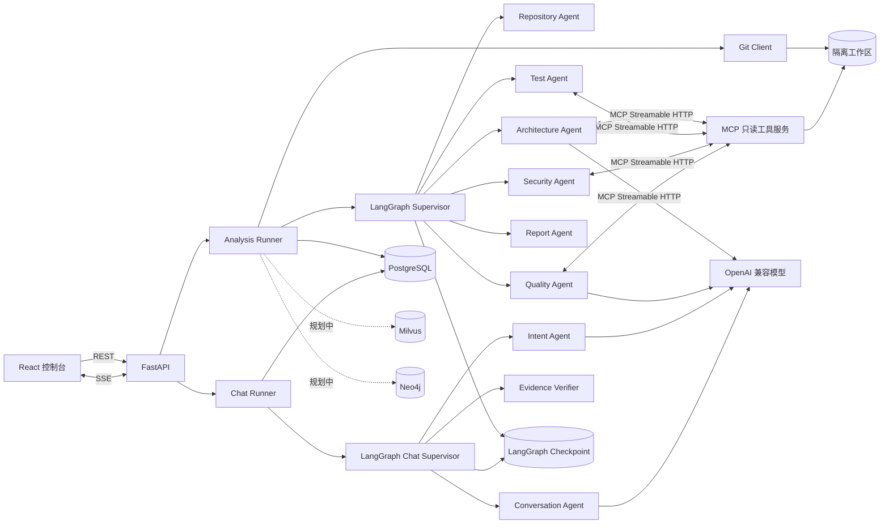
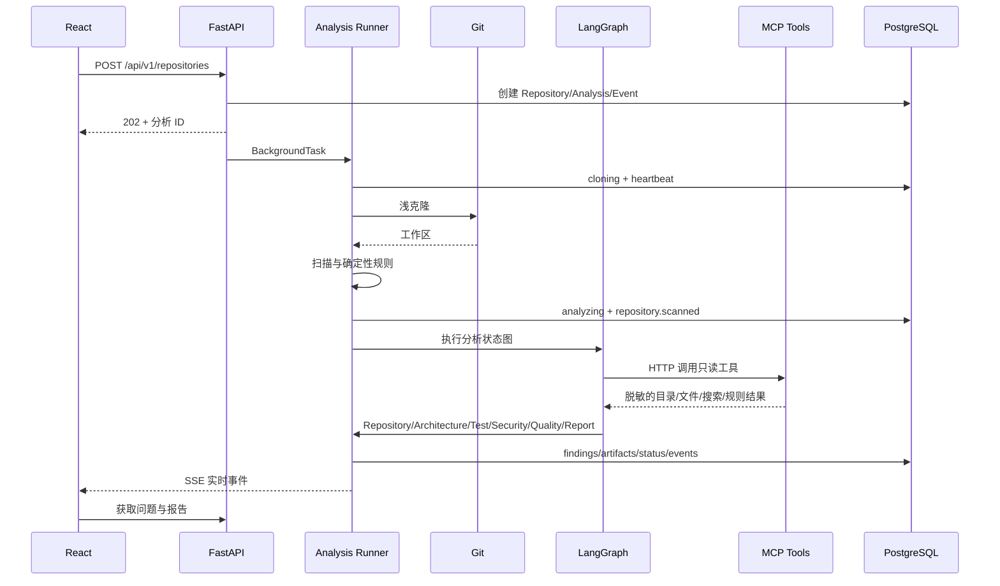
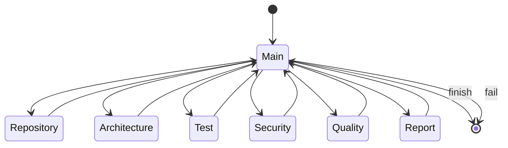
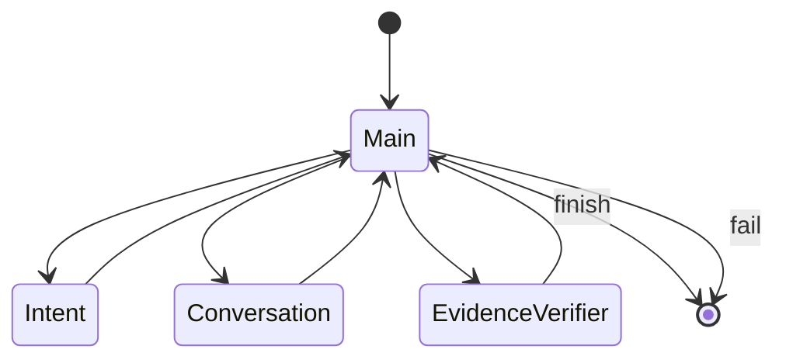

# RepoGraph 系统架构

更新时间：2026-11-03

## 1. 总体结构



当前主链路为：

```text
React -> FastAPI -> Analysis Runner -> Git 浅克隆 -> 仓库扫描
      -> LangGraph 主 Agent -> 六个专业 Agent
      -> MCP Streamable HTTP 只读工具 -> PostgreSQL 产物与事件
```

分析完成后，聊天链路为：

```text
React -> FastAPI -> Chat Runner -> 加载最近完成分析与 Finding
      -> LangGraph 聊天主 Agent -> Intent -> Conversation
      -> Evidence Verifier -> PostgreSQL 消息、引用与事件 -> SSE
```

Milvus 和 Neo4j 已完成配置、健康检查与基础连接生命周期，但尚未接入分析主链路。

## 2. 代码分层

| 目录 | 责任 |
| --- | --- |
| `frontend/` | 仓库提交、历史列表、Agent 进度、问题、事件和报告 |
| `app/api/` | REST 接口、请求校验和响应模型 |
| `app/agents/supervisor.py` | 主 Agent、LangGraph 状态与合法路由 |
| `app/agents/specialists.py` | 六个专业 Agent 的具体分析逻辑 |
| `app/agents/chat_specialists.py` | Intent、Conversation 和 Evidence Verifier 三个聊天 Agent |
| `app/agents/schemas.py` | Architecture 和 Quality 的结构化输出协议 |
| `app/services/repository.py` | URL 校验、克隆、扫描和进程清理 |
| `app/services/static_analysis.py` | 可复现的安全与质量规则 |
| `app/services/analysis_runner.py` | 后台执行、取消、心跳、持久化和报告 |
| `app/services/analysis_events.py` | 事件序号与数据库写入 |
| `app/services/chat_runner.py` | 聊天工作流、历史消息、Finding 证据和引用持久化 |
| `app/services/chat_events.py` | 聊天事件序号与数据库写入 |
| `app/services/redaction.py` | MCP、分析结果、聊天证据与回答的统一脱敏 |
| `app/mcp/server.py` | 五个 MCP 只读工具、路径沙箱和脱敏 |
| `app/mcp/client.py` | MCP Streamable HTTP 客户端 |
| `app/agents/tools.py` | Agent 工具权限、LangChain 包装和工具事件 |
| `app/db/` | SQLAlchemy 模型、连接池和建表 |
| `app/graph/` | Neo4j 驱动、约束和健康检查 |
| `app/core/` | 配置、日志和运行参数 |

## 2.1 Service 层职责

`app/services/` 是业务服务层，负责执行完整任务并协调文件系统、数据库、MCP 和 Agent。API 路由只处理 HTTP 请求和响应，Agent 只负责判断与分析，具体副作用由 Service 统一执行。

```text
FastAPI 路由
  -> Service 业务编排
  -> Git / 文件系统 / PostgreSQL / MCP / LangGraph
```

| 文件 | 职责 |
| --- | --- |
| `repository.py` | URL 白名单、Git 路径定位、浅克隆、仓库扫描和进程清理 |
| `analysis_runner.py` | 完整分析流程、取消、心跳、恢复、产物写入和最终状态更新 |
| `static_analysis.py` | 可复现的凭证、命令执行、异常和日志规则 |
| `analysis_events.py` | 单个分析内的事件序号和持久化 |
| `report_visuals.py` | SVG 图表、内嵌图片 Markdown 和自包含 HTML 报告 |
| `chat_runner.py` | 加载已完成分析、执行聊天 LangGraph、保存回答和 Finding 引用 |
| `chat_events.py` | 单个聊天会话内的事件序号和持久化 |
| `redaction.py` | 证据、聊天内容、引用摘要和失败信息的敏感值替换 |

一次“开始分析”请求的 Service 调用步骤：

1. `api/routes/repositories.py` 创建仓库和分析记录。
2. `analysis_runner.py` 启动后台任务并更新运行状态。
3. `repository.py` 完成浅克隆和受限扫描。
4. `analysis_runner.py` 调用 LangGraph 主 Agent 和专业 Agent。
5. Agent 通过 MCP 调用静态规则、文件读取和搜索能力。
6. `report_visuals.py` 生成 Markdown、HTML 与 SVG。
7. Service 在同一事务中保存问题、产物和最终状态。

Service 不决定“下一步分析谁”，该职责属于主 Agent；Service 也不直接接受 HTTP 参数，该职责属于 API 层。

## 3. 一次分析的时序



## 4. 主 Agent 状态机



主 Agent 每一步读取 `completed_agents`，只选择声明序列中的下一个 Agent。某个 Agent 返回失败或 Token 预算超限时，图进入失败终点，后续 Agent 不再执行。

## 5. 运行状态

| 状态 | 含义 |
| --- | --- |
| `pending` | 数据库任务已创建，尚未开始 |
| `cloning` | 正在浅克隆和扫描 |
| `analyzing` | LangGraph 正在调度专业 Agent |
| `completed` | 报告和问题已成功持久化 |
| `failed` | 克隆、扫描、模型调用或工作流失败 |
| `cancelled` | 用户主动停止 |

终止状态为 `completed`、`failed` 和 `cancelled`。SSE 发现终止状态后关闭连接，前端停止耗时计时。

## 6. 失败、取消与恢复

- 克隆使用独立进程和超时；超时或取消时终止子进程树。
- 后台任务每 15 秒更新心跳。
- 应用启动时将心跳超过 60 秒的运行标记为失败。
- 用户取消时先写入 `cancelled` 事件，再取消内存中的异步任务。
- Agent 异常被转换为失败结果，主 Agent 不覆盖失败。
- 外部模型不可用时不生成模拟结论，任务明确失败。

## 7. 事件与前端同步

- 所有事件有单调递增的 `sequence`。
- 事件时间由 Python 应用写入 UTC，避免 PostgreSQL 服务器时钟或时区偏差影响相对耗时。
- SSE 按 `sequence` 追平数据库中的新事件。
- 前端去重后按序号排序，避免重连时重复展示。
- 页面只在运行状态下监听 SSE；历史停止时不再持续请求。
- MCP 工具调用会生成 `tool.started`、`tool.completed` 或 `tool.failed` 事件。

后端展示分析过程通过三类接口完成：

| 接口 | 用途 |
| --- | --- |
| `GET /api/v1/analyses/{id}` | 当前状态、当前 Agent、开始和完成时间 |
| `GET /api/v1/analyses/{id}/events` | 历史事件回放 |
| `GET /api/v1/analyses/{id}/events/stream` | SSE 实时事件 |

React 不自行模拟进度，而是根据真实事件渲染 Agent 轨道、工具调用、时间线和失败原因。

## 8. MCP 工具层

- 服务端点：`http://127.0.0.1:{APP_PORT}/mcp/`
- 传输协议：MCP Streamable HTTP
- 服务端：`mcp==2.3.0` 的 `MCPServer`
- Agent 客户端：每个工具调用创建独立 MCP 会话
- 工具权限按 Agent 角色限制
- 工具路径只能位于 `workspaces/repositories/{analysis_id}`
- 工具返回内容经过长度限制和敏感值脱敏
- 单个 Agent 默认最多调用 3 次工具

工具只读取克隆后的仓库，不执行构建、测试或目标仓库脚本。

## 9. 数据边界

| 存储 | 内容 |
| --- | --- |
| PostgreSQL | 仓库、分析、事件、问题、产物元数据 |
| LangGraph checkpoint | 图节点状态和恢复信息 |
| 文件工作区 | 克隆仓库、报告、问题 JSON、仓库快照 |
| PostgreSQL 聊天表 | 聊天会话、消息、Finding 引用和聊天事件 |
| Milvus | 后续代码和文档向量检索 |
| Neo4j | 后续代码实体和依赖关系 |

## 10. 安全设计

- 只允许 HTTPS/HTTP 白名单主机。
- 禁止 URL 内嵌认证信息。
- 不运行被审查仓库代码。
- 不使用审计命令污染目标仓库。
- 限制仓库体积、文件数、源码摘要长度和克隆时间。
- 错误响应只暴露异常类型，不返回密钥和数据库连接串。
- MCP 不提供 Shell 和任意网络工具；默认客户端只访问本机端点，远程部署必须增加认证和网络隔离。

## 11. 扩展点

- 在扫描后增加代码切块、Embedding 和 Milvus 检索。
- 在 Architecture/Quality Agent 前注入历史代码和团队规范上下文。
- 增加 Java 解析器并写入 Neo4j 图谱。
- 使用后台任务队列替换 FastAPI 进程内任务，支持多 Worker。
- 增加数据库迁移和对象存储，支持生产部署。

## 12. 聊天工作流

聊天当前已经是可运行 MVP，而不是占位接口。只有已完成的分析可以创建聊天消息；同一会话在上一条回答生成期间会拒绝并发提问。



- 主 Agent 使用确定性 LangGraph 路由，只按 Intent、Conversation、Evidence Verifier 顺序推进。
- Intent Agent 识别 `ask_follow_up`、`explain_finding`、`remediation_plan` 或 `clarify`。
- Conversation Agent 使用最近消息、分析摘要和最多 50 条 Finding 生成中文 JSON 回答，并从流式 JSON 中逐步提取 `answer` 字段。
- Evidence Verifier 是确定性校验器，只保留真实存在且由回答声明的 Finding ID。
- 没有有效引用时，回答必须明确提示证据不足。
- 聊天不直接读取完整仓库，不调用 Shell、测试或构建命令，也不伪造执行结果。
- 模型输入、回答、Finding 引用摘要和失败信息统一经过脱敏。
- 回答正文按行或安全长度拆为 `chat.answer.delta` 事件；前端在最终完成前即可看到逐步输出。
- 界面只展示 Agent 阶段和可观测执行状态，不展示模型隐藏推理。

当前聊天 API：

| 接口 | 用途 |
| --- | --- |
| `POST /api/v1/chat/sessions` | 创建绑定仓库和已完成分析的会话 |
| `GET /api/v1/chat/sessions` | 查询会话 |
| `GET /api/v1/chat/sessions/{id}/messages` | 读取消息 |
| `POST /api/v1/chat/sessions/{id}/messages` | 保存用户消息并后台启动聊天图 |
| `GET /api/v1/chat/messages/{id}/citations` | 查询助手回答引用的 Finding |
| `GET /api/v1/chat/sessions/{id}/events` | 回放聊天事件 |
| `GET /api/v1/chat/sessions/{id}/events/stream` | 通过 SSE 增量推送聊天事件 |

聊天事件使用 `chat.turn.queued`、`chat.turn.started`、`chat.main.decision`、`chat.agent.started`、`chat.agent.completed`、`chat.agent.failed`、`chat.answer.delta`、`chat.completed` 和 `chat.failed`。SSE 支持 `after_sequence`，连续提问时只订阅新一轮开始后的事件。
