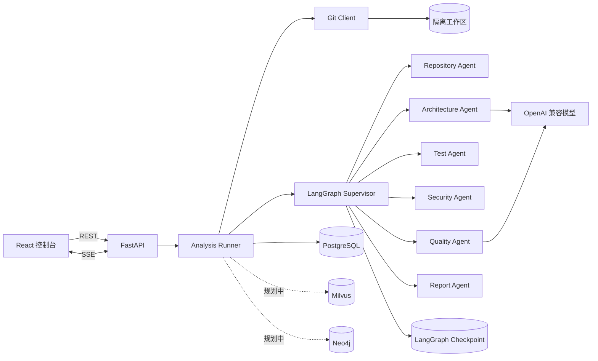
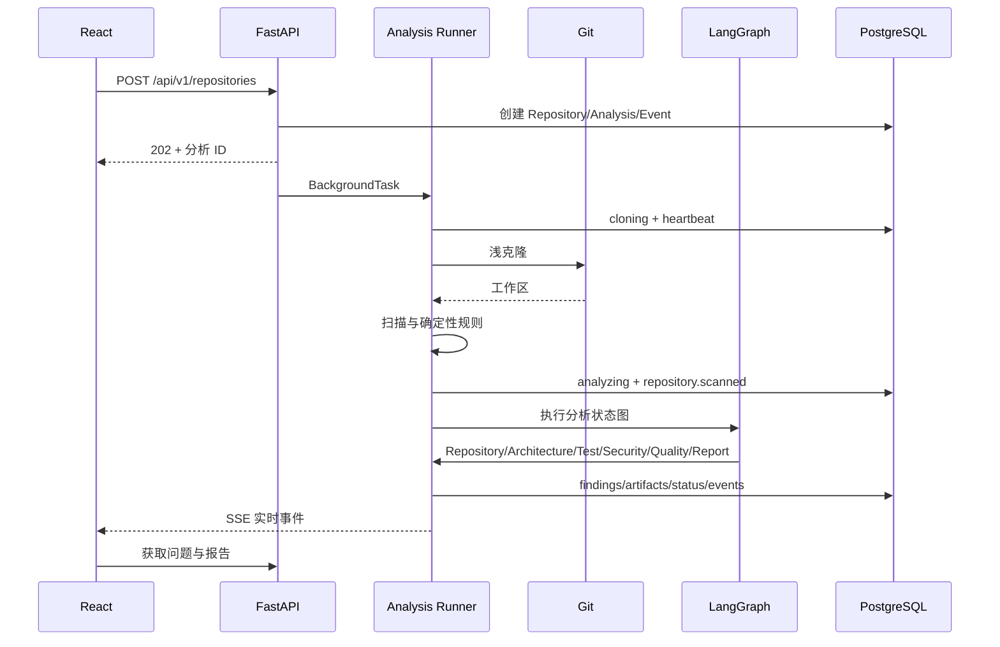
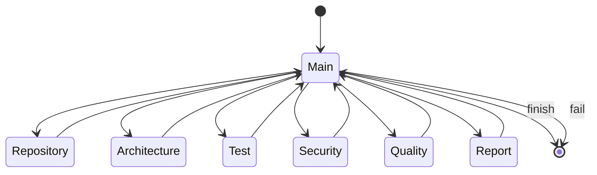

# RepoGraph 系统架构

更新时间：2026-11-03

## 1. 总体结构



当前主链路为：

```text
React -> FastAPI -> Analysis Runner -> Git 浅克隆 -> 仓库扫描
      -> LangGraph 主 Agent -> 六个专业 Agent -> PostgreSQL 产物与事件
```

Milvus 和 Neo4j 已完成配置、健康检查与基础连接生命周期，但尚未接入分析主链路。

## 2. 代码分层

| 目录 | 责任 |
| --- | --- |
| `frontend/` | 仓库提交、历史列表、Agent 进度、问题、事件和报告 |
| `app/api/` | REST 接口、请求校验和响应模型 |
| `app/agents/supervisor.py` | 主 Agent、LangGraph 状态与合法路由 |
| `app/agents/specialists.py` | 六个专业 Agent 的具体分析逻辑 |
| `app/agents/schemas.py` | Architecture 和 Quality 的结构化输出协议 |
| `app/services/repository.py` | URL 校验、克隆、扫描和进程清理 |
| `app/services/static_analysis.py` | 可复现的安全与质量规则 |
| `app/services/analysis_runner.py` | 后台执行、取消、心跳、持久化和报告 |
| `app/services/analysis_events.py` | 事件序号与数据库写入 |
| `app/db/` | SQLAlchemy 模型、连接池和建表 |
| `app/graph/` | Neo4j 驱动、约束和健康检查 |
| `app/core/` | 配置、日志和运行参数 |

## 3. 一次分析的时序



## 4. 主 Agent 状态机



主 Agent 每一步读取 `completed_agents`，只选择声明序列中的下一个 Agent。某个 Agent 返回失败或 Token 预算超限时，图进入失败终点，后续 Agent 不再执行。

## 5. 运行状态

| 状态 | 含义 |
| --- | --- |
| `pending` | 数据库任务已创建，尚未开始 |
| `cloning` | 正在浅克隆和扫描 |
| `analyzing` | LangGraph 正在调度专业 Agent |
| `completed` | 报告和问题已成功持久化 |
| `failed` | 克隆、扫描、模型调用或工作流失败 |
| `cancelled` | 用户主动停止 |

终止状态为 `completed`、`failed` 和 `cancelled`。SSE 发现终止状态后关闭连接，前端停止耗时计时。

## 6. 失败、取消与恢复

- 克隆使用独立进程和超时；超时或取消时终止子进程树。
- 后台任务每 15 秒更新心跳。
- 应用启动时将心跳超过 60 秒的运行标记为失败。
- 用户取消时先写入 `cancelled` 事件，再取消内存中的异步任务。
- Agent 异常被转换为失败结果，主 Agent 不覆盖失败。
- 外部模型不可用时不生成模拟结论，任务明确失败。

## 7. 事件与前端同步

- 所有事件有单调递增的 `sequence`。
- SSE 按 `sequence` 追平数据库中的新事件。
- 前端去重后按序号排序，避免重连时重复展示。
- 页面只在运行状态下监听 SSE；历史停止时不再持续请求。

## 8. 数据边界

| 存储 | 内容 |
| --- | --- |
| PostgreSQL | 仓库、分析、事件、问题、产物元数据 |
| LangGraph checkpoint | 图节点状态和恢复信息 |
| 文件工作区 | 克隆仓库、报告、问题 JSON、仓库快照 |
| Milvus | 后续代码和文档向量检索 |
| Neo4j | 后续代码实体和依赖关系 |

## 9. 安全设计

- 只允许 HTTPS/HTTP 白名单主机。
- 禁止 URL 内嵌认证信息。
- 不运行被审查仓库代码。
- 不使用审计命令污染目标仓库。
- 限制仓库体积、文件数、源码摘要长度和克隆时间。
- 错误响应只暴露异常类型，不返回密钥和数据库连接串。

## 10. 扩展点

- 在扫描后增加代码切块、Embedding 和 Milvus 检索。
- 在 Architecture/Quality Agent 前注入历史代码和团队规范上下文。
- 增加 Java 解析器并写入 Neo4j 图谱。
- 使用后台任务队列替换 FastAPI 进程内任务，支持多 Worker。
- 增加数据库迁移和对象存储，支持生产部署。
