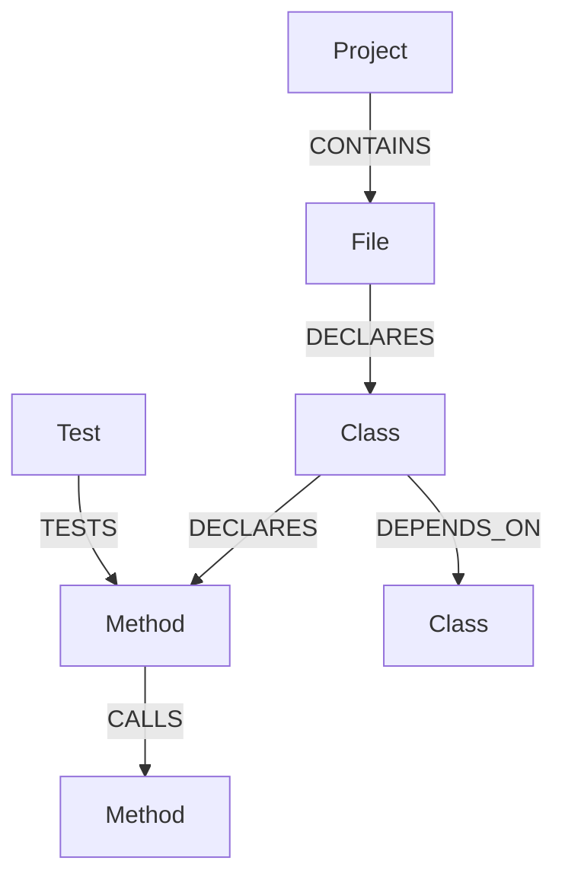

# Neo4j 代码图谱设计

更新时间：2026-11-03

## 1. 当前状态

当前版本已经实现：

- Neo4j 异步驱动生命周期。
- Bolt 连接验证。
- Project、File、Class、Method 和 Test 唯一约束初始化。
- `RETURN 1` 健康检查。
- `scripts/verify_neo4j.py` 验证脚本。

当前版本尚未实现：

- 在每次仓库分析时自动写入完整代码图谱。
- Java AST 解析和真实调用关系识别。
- 前端交互式依赖图。

因此当前 Neo4j 是后续图谱能力的可运行基础设施，不能把健康检查成功描述为“已完成代码依赖分析”。

## 2. 目标模型



节点：

| 节点 | 关键属性 |
| --- | --- |
| Project | `id`、`name`、`repository_url`、`commit_sha` |
| File | `project_id`、`path`、`language` |
| Class | `fqn`、`name`、`file_path` |
| Method | `fqn`、`signature`、`file_path`、`line` |
| Test | `fqn`、`framework`、`file_path` |

关系：

- `CONTAINS`
- `DECLARES`
- `DEPENDS_ON`
- `CALLS`
- `TESTS`

## 3. 约束

应用初始化时创建：

```cypher
CREATE CONSTRAINT project_id IF NOT EXISTS
FOR (p:Project) REQUIRE p.id IS UNIQUE;

CREATE CONSTRAINT file_key IF NOT EXISTS
FOR (f:File) REQUIRE (f.project_id, f.path) IS UNIQUE;

CREATE CONSTRAINT class_fqn IF NOT EXISTS
FOR (c:Class) REQUIRE c.fqn IS UNIQUE;

CREATE CONSTRAINT method_fqn IF NOT EXISTS
FOR (m:Method) REQUIRE m.fqn IS UNIQUE;

CREATE CONSTRAINT test_fqn IF NOT EXISTS
FOR (t:Test) REQUIRE t.fqn IS UNIQUE;
```

## 4. 配置

```dotenv
NEO4J_URI=bolt://localhost:7687
NEO4J_USER=neo4j
NEO4J_PASSWORD=replace-with-a-strong-password
```

密码只保存在 `.env`。未配置时健康检查返回 `not_configured`，不阻止仓库基础分析启动。

## 5. 验证

```powershell
& 'D:\itwork\itwork2026\app\Miniconda3\envs\multiagent\python.exe' -m scripts.verify_neo4j
```

验证脚本会建立临时图谱、查询依赖路径并清理测试数据。

## 6. 后续接入方案

1. 从仓库扫描结果中筛选 Java、Kotlin 等源码。
2. 使用语法解析器提取包、类、方法、注解、调用和测试。
3. 以分析 ID 和 Commit 作为版本边界批量写入 Neo4j。
4. 通过文件、类和方法关系补充架构问题证据。
5. 提供按影响范围查询的 API 和前端图谱视图。

在语法解析可靠前，不应使用正则猜测结果冒充真实调用图。
