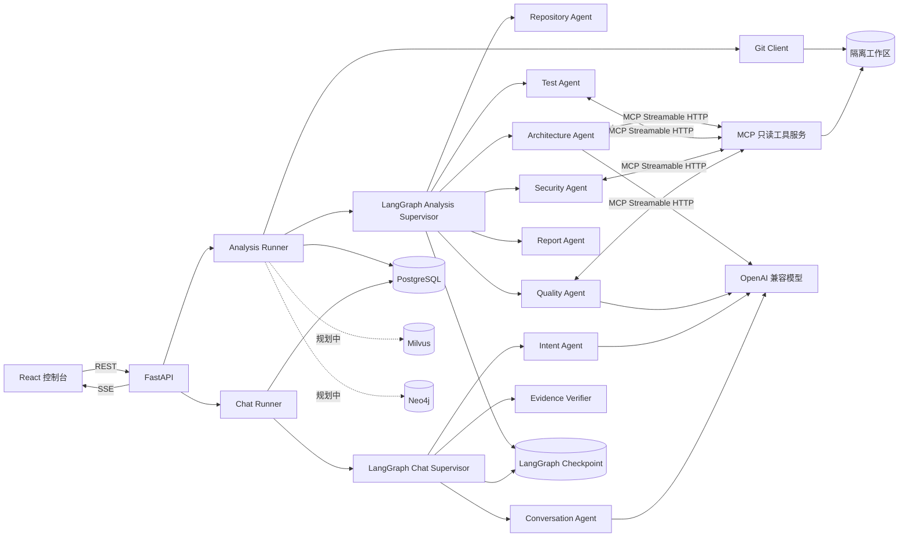

# RepoGraph 项目开发与对话日志

更新时间：2026-11-04

## 1. 文档说明

本文档记录 RepoGraph 从项目方向选择到当前版本的开发过程、关键决策、用户需求变化、完成结果和 Git 提交历史。

- 对话部分是可追溯摘要，不是模型逐字逐句的原始输出。
- 文档不记录 API Key、数据库密码、Token、私钥或完整 `.env`。
- 对话中出现过的凭据应视为已经暴露，需要由用户撤销并重新创建。
- 后续重要功能、项目方向或架构决策发生变化时，应继续在本文档追加记录。

## 2. 项目当前成果

RepoGraph 已从“多 Agent 生成完整软件项目”重构为“对公开 Git 仓库进行只读静态分析”的平台。

当前主要能力：

- 接收 GitHub、GitLab 和 Gitee 的公开 HTTPS 仓库地址。
- 使用 `git clone --depth 1 --single-branch` 获取指定分支。
- 扫描文件、语言、构建文件、测试文件、入口类和 Spring Boot 特征。
- 主 Agent 按 LangGraph 固定顺序调度六个分析 Agent。
- 生成架构、测试、安全、质量四类可定位 Finding。
- 通过 MCP Streamable HTTP 提供五个只读代码证据工具。
- 使用 SSE 实时展示克隆、Agent、MCP 工具、失败和取消状态。
- 展示严重级别环形图、分类条形图和分类问题列表。
- 生成带内嵌图表的 Markdown 和自包含 HTML 报告。
- 支持在线查看和下载 HTML、Markdown 报告。
- 分析完成后通过独立“AI 助手”基于 Finding 进行问答。
- 聊天由主 Agent、Intent、Conversation 和 Evidence Verifier 协作。
- Conversation Agent 使用真实流式输出。
- 聊天前端展示 Agent 阶段、流式正文和可展开引用证据。
- PostgreSQL 保存仓库、分析、事件、Finding、聊天和 checkpoint。
- Milvus 和 Neo4j 已有配置与健康检查。

当前尚未实现：

- Milvus 代码切块、Embedding、向量写入和相似代码检索。
- Neo4j 文件、类、方法和依赖关系自动建图。
- 私有仓库、用户登录、多租户和权限隔离。
- 执行目标仓库的构建、测试或运行期分析。

## 3. 当前架构



## 4. 关键技术决策

| 决策 | 原因 |
| --- | --- |
| 从代码生成转向仓库分析 | 完整代码生成错误多、重试成本高，结果难以稳定验证 |
| Python 3.11.18 + Conda | 适应当前 FastAPI、LangGraph、MCP 和异步数据库环境 |
| FastAPI + React | 后端提供 REST/SSE/OpenAPI，前端提供实时控制台 |
| PostgreSQL | 保存业务状态、事件、Finding、聊天和 LangGraph checkpoint |
| 主 Agent 使用确定性路由 | 保证执行顺序、失败处理和可复现性 |
| 六个分析 Agent 分工 | 降低单个 Agent 复杂度，便于定位和扩展 |
| MCP 只读工具 | 禁止 Shell、任意网络请求和目标仓库写入 |
| Finding 必须带证据 | 避免无法定位和验证的自然语言结论 |
| 聊天只基于 Finding | 控制上下文、Token、安全和幻觉风险 |
| Evidence Verifier 不调用模型 | 用确定性逻辑删除伪造或重复 Finding ID |
| 聊天使用流式输出 | 用户无需等待完整回答即可看到输出和 Agent 阶段 |
| Milvus 按需索引而非每次分析写入 | 减少普通分析等待时间，适合后续代码追问 |
| Neo4j 暂缓自动建图 | 基础分析不依赖图谱，图谱作为后续增强能力 |

## 5. 开发阶段记录

### 阶段 1：项目方向选择

最初在两个方向之间比较：

- 多 Agent 软件开发协作小队。
- 面向领域文献的多 Agent 综述系统。

随后选择软件开发协作方向，设想由 PM、Architect、Coder、Tester、Reviewer 和 Doc Agent 生成 Spring Boot 项目，并接入 Neo4j、Milvus、重试和 Agent 通信。

### 阶段 2：第一版多 Agent 代码生成平台

完成内容：

- 用户提交需求。
- 主 Agent 调度多个专业 Agent。
- 展示 Agent 运行过程。
- 提供任务历史页面。
- 接入 PostgreSQL、Milvus、Neo4j 健康检查。
- 增加中文启动日志、停止任务和运行耗时。

实际测试发现：

- 复杂代码任务难以稳定交付。
- 生成代码的错误修复和重试成本较高。
- Token 消耗和运行时间不易控制。
- 分析已有仓库比从零生成完整系统更容易形成稳定成果。

### 阶段 3：重构为仓库分析系统

完成内容：

- 接收公开 Git URL。
- 使用浅克隆获取代码。
- 增加 Repository、Architecture、Test、Security、Quality 和 Report Agent。
- 增加 MCP Streamable HTTP 只读工具。
- 增加工作区隔离、路径校验、大小限制和脱敏。
- 增加分析事件、Finding 和报告持久化。

该阶段确定的核心约束：

- 不执行目标仓库代码。
- 不修改、提交或推送目标仓库。
- 每个分析必须有唯一主 Agent。
- 子 Agent 失败时不能伪造成功。

### 阶段 4：环境和启动体验

完成内容：

- 固定 Python 3.11.18 和 Conda `multiagent`。
- 使用 PostgreSQL 保存业务数据和 checkpoint。
- 接入 DeepSeek OpenAI 兼容模型。
- 支持 `.env` 和 `.env.local`。
- 增加依赖、环境变量和数据库文档。
- 增加 `dev.py` 同时启动 FastAPI、MCP 和 React。
- 启动、就绪、错误和关闭日志使用中文。

### 阶段 5：分析主链路和可视化

完成内容：

- Git 浅克隆、仓库扫描和有限源码摘要。
- 架构、测试、安全和质量分析。
- 主 Agent 按声明顺序调度专业 Agent。
- SSE 实时进度和断点续传。
- 可取消正在运行的分析。
- 当前 Agent、运行耗时和真实失败原因展示。
- Findings 严重级别筛选和分类展示。
- 详细执行开关展示 MCP 参数、结果和耗时。

### 阶段 6：报告与图表

完成内容：

- 严重级别环形图。
- 分类条形图。
- 按架构、测试、安全、质量分组的问题列表。
- Markdown 报告。
- 带内嵌 SVG 图表的自包含 HTML 报告。
- 报告在线查看和下载。

### 阶段 7：聊天持久化基础

完成内容：

- `chat_sessions`
- `chat_messages`
- 聊天 REST API
- 消息状态和 Token 用量
- PostgreSQL 持久化

该阶段尚未生成真实助手回答。

### 阶段 8：证据聊天 MVP

完成内容：

- 聊天主 Agent。
- Intent Agent。
- Conversation Agent。
- Evidence Verifier。
- `chat_citations`
- `chat_events`
- 基于 Finding 的引用回答。
- 没有有效证据时明确提示证据不足。
- 同一会话禁止并发提问。
- 聊天 SSE 和 `after_sequence`。
- MCP、Finding、聊天输入、回答和引用统一脱敏。

重要设计：

- 主 Agent 不调用模型。
- Intent 和 Conversation 调用聊天模型。
- Evidence Verifier 使用确定性校验。
- 聊天只基于已完成分析。

### 阶段 9：独立 AI 助手界面

完成内容：

- 顶栏独立“AI 助手”入口。
- 左侧分析上下文和最近对话。
- 居中欢迎语和三张快捷问题卡片。
- 底部大输入框。
- 用户和助手消息样式。
- Finding 引用可展开。
- Markdown 标题、列表、加粗、代码块和表格。
- 桌面和移动端响应式布局。

### 阶段 10：真实流式输出

完成内容：

- Conversation Agent 使用模型 `astream()`。
- 从尚未完成的 JSON 中提取 `answer` 字段。
- 按完整行或安全长度拆分正文。
- 通过 `chat.answer.delta` 推送增量。
- 前端增量拼接回答和显示流式光标。
- 显示 Intent、Conversation 和 Evidence Verifier 阶段。
- 重新打开生成中的会话时恢复增量内容。
- 只显示可观测阶段，不显示模型隐藏思维链。

真实浏览器测试中，正文长度在回答结束前从 74 增长到 249、330、382，确认不是结束后的伪动画。

### 阶段 11：文档和项目日志

完成内容：

- `docs/USER_MANUAL.md`
- 安装、环境、数据库、Git、模型和服务配置。
- 启动、停止、健康检查和常见故障。
- 仓库分析和 AI 助手使用流程。
- 后续更新时同步维护手册的项目规则。
- 本文档汇总开发过程和对话摘要。

## 6. 用户对话日志摘要

### 6.1 方向选择与产品需求

| 序号 | 用户诉求 | 最终处理 |
| --- | --- | --- |
| 1 | 比较两个多 Agent 项目方向 | 先选择软件开发协作小队 |
| 2 | 使用 Milvus、Neo4j 和关系数据库 | 配置健康检查，业务数据最终使用 PostgreSQL |
| 3 | 确认 Python 版本和虚拟环境 | 固定 Python 3.11.18 和 Conda `multiagent` |
| 4 | 使用 FastAPI 提供平台接口 | FastAPI 成为后端入口 |
| 5 | 项目规则和界面使用中文 | 文档、提示词和界面默认中文 |
| 6 | 说明 MVP、输入示例和代码可运行性 | 后续改为静态分析，不执行目标代码 |
| 7 | 安装依赖并记录版本 | 创建 requirements 和依赖文档 |
| 8 | 必须有主 Agent | 分析和聊天均使用确定性主 Agent |
| 9 | 需要项目使用手册 | 最终新增用户使用手册 |

### 6.2 环境、GitHub 和数据库

| 序号 | 用户诉求 | 最终处理 |
| --- | --- | --- |
| 10 | 初始化 Git 并推送 GitHub | 完成 `main` 和功能分支推送 |
| 11 | 使用本机 PostgreSQL | 完成建表、事件时间和 checkpoint 修复 |
| 12 | 配置 Milvus、Neo4j 和 Docker | 完成健康检查，尚未自动写入业务数据 |
| 13 | 缩短后端启动和减少日志 | 增加快捷入口并关闭逐请求访问日志 |
| 14 | 说明 Service、文件结构和主 Agent 提示词 | 补充架构、数据库和提示词文档 |
| 15 | 清理无用数据库数据和旧文档 | 删除测试数据、旧 schema 和失效说明 |
| 16 | 修复 MCP 文件读取失败 | 扩展可读取源码、配置和构建文本 |

### 6.3 从代码生成转向仓库分析

| 序号 | 用户诉求 | 最终处理 |
| --- | --- | --- |
| 17 | 测试图书管理系统等生成任务 | 发现复杂代码交付和重试成本过高 |
| 18 | 增加停止、耗时和工具过程展示 | 完成取消、耗时、MCP 事件和详细时间线 |
| 19 | 减少重试并考虑更换方向 | 重构为 Git 仓库分析系统 |
| 20 | 上传 Git 地址后开始分析 | 完成仓库分析 MVP |
| 21 | 增加 MCP HTTP 工具 | 接入 Streamable HTTP 只读工具 |
| 22 | 中文启动日志并改善颜色 | 完成中文启动、关闭和对比度调整 |
| 23 | 报告可下载、分类并带图表 | 完成 Markdown/HTML、环形图和条形图 |
| 24 | 提供仓库进行真实测试 | 使用多个公开仓库完成实际验证 |

### 6.4 可视化和 Agent 可观测性

| 序号 | 用户诉求 | 最终处理 |
| --- | --- | --- |
| 25 | 首屏不自动展示最后一次分析 | 首次进入只加载仓库列表 |
| 26 | 左右栏分别滚动 | 桌面端使用独立滚动区域 |
| 27 | 展示 Agent 和工具内部步骤 | 增加详细执行开关和 Agent 轨迹 |
| 28 | 开始分析后展示分析过程 | 增加 SSE 时间线和 Agent 状态 |
| 29 | 说明项目亮点和提示词位置 | 补充架构、亮点和提示词文档 |

### 6.5 AI 助手

| 序号 | 用户诉求 | 最终处理 |
| --- | --- | --- |
| 30 | 增加聊天模型和多 Agent | 增加 Intent、Conversation、Evidence Verifier |
| 31 | 聊天入口要容易找到 | 改为顶栏独立入口 |
| 32 | 聊天样式参考现代助手 | 左侧会话、中间欢迎区、底部输入器 |
| 33 | 快捷问题不明显 | 改为居中问题建议卡片 |
| 34 | 回答必须关联 Finding | 增加引用表、Evidence Verifier 和可展开引用 |
| 35 | Milvus 只在代码追问时写入 | 记录为后续按需索引方向，当前未实现 |
| 36 | AI 回答改为流式输出 | 使用 `astream()` 和 `chat.answer.delta` |
| 37 | 用户要看到 Agent 是否在思考 | 展示 Agent 阶段和流式正文光标 |

### 6.6 文档维护

| 序号 | 用户诉求 | 最终处理 |
| --- | --- | --- |
| 38 | 解释数据库每个表的职责 | 补充表职责和字段说明 |
| 39 | 每次变化同步写文档 | 写入项目维护规则 |
| 40 | 提供完整用户手册 | 新增 `docs/USER_MANUAL.md` |
| 41 | 汇总完成工作和对话日志 | 新增本文档 |

## 7. 当前核心文件

### 后端

| 路径 | 职责 |
| --- | --- |
| `app/agents/supervisor.py` | 分析和聊天的 LangGraph 主 Agent |
| `app/agents/specialists.py` | 六个仓库分析 Agent |
| `app/agents/chat_specialists.py` | 三个聊天 Agent 和流式回答 |
| `app/services/analysis_runner.py` | 分析后台编排、取消和持久化 |
| `app/services/chat_runner.py` | 聊天执行、回答和引用保存 |
| `app/services/redaction.py` | 统一敏感信息脱敏 |
| `app/mcp/server.py` | 五个只读 MCP 工具 |
| `app/api/routes/analyses.py` | 分析、事件、Finding 和报告 API |
| `app/api/routes/chat.py` | 聊天 REST 和 SSE API |

### 前端

| 路径 | 职责 |
| --- | --- |
| `frontend/src/App.tsx` | 仓库分析主控制台 |
| `frontend/src/ChatWorkspace.tsx` | 独立 AI 助手工作区 |
| `frontend/src/ExecutionDetails.tsx` | Agent 和工具执行详情 |
| `frontend/src/api.ts` | 后端接口封装 |
| `frontend/src/styles.css` | 控制台和聊天界面样式 |

### 文档

| 路径 | 职责 |
| --- | --- |
| `docs/USER_MANUAL.md` | 安装、配置、启动和使用 |
| `docs/ARCHITECTURE.md` | 系统架构 |
| `docs/ANALYSIS_MODEL.md` | Agent 和分析模型 |
| `docs/DATABASE.md` | PostgreSQL 设计 |
| `docs/FRONTEND.md` | 前端交互 |
| `docs/MCP_TOOLS.md` | MCP 工具和权限 |
| `docs/ENVIRONMENT_VARIABLES.md` | 环境变量 |
| `docs/DEPENDENCIES.md` | 依赖和版本 |
| `docs/PROJECT_REQUIREMENTS.md` | 需求和验收标准 |

## 8. 验证与质量记录

当前自动检查：

- Ruff
- mypy
- pytest
- TypeScript 类型检查
- Vite 生产构建
- Git diff 空白检查

最近一次完整检查结果：

```text
Ruff: All checks passed
mypy: no issues found in 52 source files
pytest: 30 passed
frontend build: passed
```

实际验证过的场景：

- Spring PetClinic 完成真实仓库分析。
- 多个酒店管理项目完成结构和规则分析。
- MCP 文件读取失败修复后重新验证。
- 聊天调用真实 DeepSeek 模型。
- 同一聊天会话连续提问，SSE 只接收新事件。
- Finding 引用和聊天事件写入 PostgreSQL。
- 模拟密码、Token 和密钥显示为 `<REDACTED>`。
- AI 助手在回答结束前逐步输出正文。
- 桌面和移动端聊天布局经过截图检查。

## 9. 安全修正

开发过程中进行了以下安全修正：

- 真实凭据只写入本地 `.env`，不进入 Git。
- `.env.example` 只保留占位符。
- Git URL 禁止携带用户名和密码。
- MCP 路径限制在隔离工作区。
- MCP 不提供 Shell、任意网络请求或目标仓库写入。
- Finding 在进入聊天模型前脱敏。
- 流式回答和最终回答重复脱敏。
- 聊天引用摘要脱敏。
- 工具结果和失败信息限制长度。

本文档不包含对话中出现过的凭据。任何曾经暴露的 API Key 或数据库密码都应撤销并重新创建。

## 10. 已知限制

- 聊天只能使用已完成分析中的 Finding。
- 聊天不能直接回答完整仓库中的任意代码细节。
- Milvus 当前不会自动写入向量。
- Neo4j 当前不会自动写入代码依赖关系。
- 不执行 Maven、Gradle、测试或目标程序。
- 不读取 Git 历史、Issue 和 Pull Request。
- 不解析完整 Java AST 或 Maven 依赖闭包。
- 没有私有仓库、登录、权限和多租户。
- 分析结果不能替代正式安全审计。

## 11. 后续路线

1. 在用户追问具体代码时按需建立 Milvus 向量索引。
2. 按仓库和 Commit 管理索引版本，避免重复写入。
3. 将文件、类、方法和依赖写入 Neo4j。
4. 增加交互式依赖图和影响分析。
5. 增加 Java AST 和 Maven 依赖解析。
6. 增加聊天会话重命名、归档和删除。
7. 增加分析历史对比和报告模板。
8. 增加私有仓库、认证和权限隔离。
9. 将进程内后台任务改为生产级任务队列。

## 12. Git 提交历史

| 提交 | 内容 |
| --- | --- |
| `71137a8` | 初始化多 Agent 项目 |
| `1599081` | 更新开发 Token 记录 |
| `0786358` | 增加多 Agent 代码生成工作流 |
| `7ea64be` | 完成 Agent 工作台和可视化控制台 |
| `60d5d37` | 重构为仓库分析系统 |
| `3719196` | 增加 MCP 仓库分析工具 |
| `538f415` | 增加中文开发启动日志 |
| `2521bd5` | 改善状态对比和停止流程 |
| `17988c0` | 增加可下载分析报告 |
| `601c4c4` | 增加分类评估图表 |
| `16e4560` | 增加带图表可视化报告 |
| `792760c` | 修复 IDE 启动时 Git 定位 |
| `f917f75` | 修复未知 MCP 工具名恢复 |
| `346be97` | 本地环境变量优先 |
| `88119aa` | 记录 PostgreSQL 清理和备份 |
| `6c81257` | 分离 Markdown 和 HTML 下载 |
| `8afde20` | 补充 Agent 提示词和核心流程 |
| `cb1ced5` | 说明 Service 层并清理旧文档 |
| `6ee1937` | 修复分析事件时间 |
| `6648ca3` | 增加详细 Agent 执行检查器 |
| `aa4211f` | 记录聊天和多 Agent 依赖 |
| `feb3fcc` | 增加聊天持久化基础 |
| `3e0ef6f` | 说明 PostgreSQL 表职责 |
| `b4ae6ef` | 首屏不自动选择分析 |
| `d9ca23d` | 分离桌面左右栏滚动 |
| `aae6a7d` | 扩展 MCP 可读取文本文件 |
| `4a0027c` | 实现基于证据的聊天工作流 |
| `67ebef2` | 重构独立 AI 助手入口 |
| `b01d1cb` | 为 AI 助手增加流式回答 |
| `6d01721` | 新增用户使用手册 |

## 13. 文档维护要求

后续重要更新应追加：

- 用户新增或变更的需求。
- 技术方案和选择原因。
- 实际完成的文件或功能。
- 验证结果。
- 已知限制和后续工作。

不要记录：

- API Key
- 数据库密码
- 用户 Token
- 私钥
- 完整 `.env`
- 目标仓库敏感代码
- 模型隐藏推理
